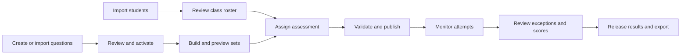

# Admin workflow: registration to released results

Status: implementation plan, 13 October 2026; updated 20 October 2026. Slice 1
(owner sign-in, roster, manual add, disable/reactivate and bulk import), slice 2
(question bank and JSON import) and slice 3 (assessment setup and publication) are
implemented, and students can take published assessments (start, save, submit,
expiry). Slice 4's live monitoring, attempt review, extensions, voids and retests are
implemented. Assessments on rules version 2 record away periods (page hidden or
unfocused) and, on computers, periods with the window smaller than the screen, with
device type and multi-screen use where the browser reports it. Students are warned
before leaving, while away (tab title) and on return; the attempt timeline shows them; review-case
dispositions and late evidence are not built. Result release is built: a Results tab
with a release checklist, release now or hold, automatic release by the worker for
assessments not held, the student result page and CSV export. Profile/email
correction for conflicting rows and audited schedule changes after publication are
not built yet. Reports are built (Reports tab). Faulty-question exclusion with a preview and durable
rescoring is built (Results tab, Scoring).
This plan follows
[the specification](../SPECIFICATION.md) and the existing Prisma schema.

The application serves one class with one owner. Use the installed shadcn preset
and shared components throughout; no role management, departments, cohorts, or
second-reviewer approval workflow is needed.

## 1. Registration workbook findings

Inspected `IYF Season 12 — Registration (Responses).xlsx` locally without importing
students or copying the workbook into the repository.

- `Form Responses 1`: 62 response rows and 10 columns.
- `Sheet1`: empty; ignore it.
- All 62 rows contain a name, registration email, admission number, and matching
  admission-number confirmation. Email/admission uniqueness checks within the
  file pass after trimming and case normalization. Both email columns pass a
  basic format check; this does not verify mailbox ownership or deliverability.
- Five GitHub emails differ from the corresponding registration emails.
- All rows identify the primary Google account as the sole Classroom account.
  Seven alternate-account cells are populated, but contain non-address responses
  such as `No` or `N/A`; they are not alternative login identities.
- GitHub usernames are populated in every row. GitHub authentication and practical
  repository grading remain outside the current assessment scope.
- The acknowledgement concerns Classroom/repository submission matching. It is
  not acknowledgement of this application's exam rules or privacy notice.

These are file-level findings. Existing database matches must still be checked
by the importer. Do not assume all 62 rows would create new accounts.

### Column mapping

| Source column | Import behavior |
| --- | --- |
| Full name as registered with the school | `User.displayName`; required. Trim surrounding whitespace and preserve spelling. |
| Email Address | `User.email`; required, trimmed and lowercased. This is the sole email-code login address. |
| Admission number | `User.admissionNumber`; preserve as text, including leading zeros. Use a consistent uppercase/trim policy for matching. |
| Confirm admission number | Compare with admission number during preview; do not store a duplicate field. |
| Timestamp | Source information only; not the account creation or email-verification time. |
| Google-account confirmation and alternate accounts | Ignore for account creation; do not create aliases. |
| GitHub username / Email on your GitHub account | Ignore in v1. Add profile fields later only if a concrete repository workflow needs them. |
| I understand that: | Do not turn into exam-rule acceptance, email verification, or application consent. |

Names and emails are mandatory. The domain permits an optional admission number;
this workbook provides all of them, so missing admission values in a later upload
should be visibly flagged for review rather than invented.

## 2. Main navigation and working sequence

Keep six navigation entries: **Overview, Students, Question bank, Assessments,
Results, Settings**. Reviews live inside assessments and are linked from Overview.
Audit history is accessible from Settings and from affected records.

Roster preparation and question authoring can happen independently. Publication
requires both an assigned audience and valid, reviewed sets.

## 3. Owner access and Overview

Bootstrap the sole admin using the existing seed command with the owner's email
and name, then sign in with an email code. Owner MFA is switched off for now
(`ADMIN_MFA`); when restored, authenticator setup and the additional factor are
required before privileged access.

Overview shows actionable summaries: enrolled students, draft questions, upcoming
assessments, active attempts, open reviews, and results awaiting release. Each
summary links to the relevant filtered screen. The primary next action depends
on progress: import students, prepare questions, or continue an assessment draft.

Student import never provisions an admin, verifies an email, or issues a session.

## 4. Bulk student addition

### Screen sequence

**Students → Import → Upload → Map columns → Preview → Confirm → Summary**

1. Accept `.xlsx` and a documented UTF-8 CSV student template. Default this workbook
   to its populated response sheet, with explicit sheet selection when needed.
2. Suggest mappings from recognized headers and show them for confirmation.
   Preserve the original spreadsheet row number throughout validation.
3. Normalize and validate on the server: required fields, schema lengths, email
   syntax, admission confirmation, duplicates in the file, and database conflicts.
4. Show counts and a table with name, login email, admission number, proposed
   action, and row-level reasons. No database writes occur during preview.
5. Admin fixes the source and reuploads, or explicitly excludes individual rows.
   Excluded rows are visible in the final summary; do not silently skip errors.
6. Commit the reviewed eligible rows atomically. Revalidate under database
   constraints; a conflict aborts the import rather than partially enrolling a class.
7. Show created, already-existing, excluded, and rejected totals, with links to the
   roster and a downloadable error report where needed.

### Matching and conflict policy

| Preview result | Action |
| --- | --- |
| New email and admission number | Create student on confirmation. |
| Same email, admission number, and name as an existing student | Show `Already enrolled`; no write. |
| Same identity with changed name or missing/different admission number | Flag for an explicit profile correction; no silent overwrite. |
| Same admission number, different email | Identity conflict; resolve through the email-correction workflow. |
| Email belongs to one record and admission number to another | Block the row; never merge accounts automatically. |
| Repeated email/admission number inside the upload | Flag all involved rows for resolution, including otherwise identical duplicates. |
| Existing disabled student or owner account | Flag for review; import cannot reactivate an account or alter the owner. |

Reuploading an unchanged roster creates no duplicates. A retry after a lost commit
response must not repeat changes: use a scoped idempotency key and recorded result.
Bind confirmation to the exact normalized preview and selected rows, then recheck
database state at commit. Do not trust client-supplied `isAdmin`, verification, or
account-status fields.

Do not send email during preview or automatically send login codes during import.
Students request a fresh two-minute code when they actually sign in. Any future
welcome-email action is separate, explicit, and reports delivery failures.

### Student management after import

The roster supports search by name/email/admission number, account-status filters,
manual student addition, and opening a student detail page. Detail shows identity,
email-verification state, assigned assessments, attempt history, and results.

Name/admission corrections are explicit and audited. Changing a login email
requires an identity check and reason, revokes sessions and outstanding codes,
and requires verification of the replacement address. Disabling revokes access
without deleting scores or evidence; reactivation is a separate audited action.
Show any active attempt before an account-status action so the owner understands
the consequence. Normal expiry still finalizes an interrupted attempt.

### Import implementation boundaries

For a class of this size, a bounded request and one commit transaction are enough;
no general bulk-processing platform is needed. Proposed initial upload limits:
5 MB compressed input, 1,000 data rows, bounded decompressed XML size/cell lengths,
and a bounded parser execution time. Reject encrypted workbooks, unsupported
formats, and formulas in mapped identity cells; do not execute macros or fetch
external workbook links. Select a maintained parser after a dependency review.

Do not commit registration files or personal data to Git. Keep preview state
short-lived and private, discard uploaded content after completion/expiry, and
record the actor, timestamp, counts, affected record IDs, and import outcome in
audit history. Reports must escape spreadsheet formula prefixes.

## 5. Question bank: create, review, activate

**Question bank → New question / Import JSON → Draft → Preview → Activate**

- List and filter by topic, learning objective, code/theory type, difficulty, and
  status. Show active supply per topic so assessment planning is practical.
- The editor contains prompt, optional code, language/runtime context, objective,
  topics, difficulty, expected answering time, two to six options, one correct
  option, and an explanation. Keep the answer key in the privileged admin view.
- Save drafts without making them eligible for an exam. Detect stale edits with
  the existing draft record version and show a reload/resolve prompt.
- Preview as a student to check code formatting and option layout; separately
  show the admin answer/explanation for review. Activation validates completeness
  and requires an explicit owner action. No second reviewer is required.
- JSON import has a documented schema, preview, row/item errors, and atomic commit.
  Imported questions remain drafts. Student spreadsheet import and question JSON
  import are separate workflows.
- Editing assessed content creates a new numbered version. Retiring an item stops
  future selection but leaves existing sets, answers, and scores intact.

## 6. Assessment setup and publication

**Assessments → Create → Details → Blueprint → Sets → Audience → Review & publish**

| Step | Owner actions and visible feedback |
| --- | --- |
| Details | Set title/instructions, duration, pass percentage, opening time, latest start, hard close, and result-release policy. Show all times in Africa/Nairobi. |
| Blueprint | Choose question count, set count, and slots by objective/topic/type/difficulty. Show available active questions and shortages. The code/theory default is 60/40 where the bank supports it. |
| Sets | Generate sets, inspect questions and answer keys, preview student presentation, and review overlap and estimated-time differences. Default maximum overlap is 30%. Generation failure explains shortages without weakening constraints. |
| Audience | Select all enabled students or an explicit subset. Preview the exact names/count. Apply individual schedule/duration accommodations where needed. |
| Review & publish | Show a readable checklist of audience, schedules, settings, set previews, and release policy. Publish only when every required validation passes. |

Audience selection is a snapshot, not a dynamic `all students` rule: later imports
do not silently gain access to a published exam. The initial workflow completes
assignment before publication; later additions require a separately designed,
audited eligibility change with the same schedule and release checks.

Require latest start plus authorized duration to fit within the effective hard
close for every assignment. Publication freezes question versions, set content,
question order, and scoring policy. Published schedule changes are allowed only
through the specification's explicit rules; never use a generic edit form to
change a running assessment.

Students receive a set at start, selected from the least-used sets. The owner
does not manually assign preferred sets. A retry resumes the existing attempt.

## 7. During the assessment

The assessment detail page has tabs: **Overview, Students, Sets, Live, Reviews,
Results**. Live monitoring shows assigned/not-started/active/submitted/expired/
voided counts, with a student table containing start time, deadline, last contact,
accepted-answer count, and connection/save issues.

Operational observations are neutral: an away event or missed heartbeat is not
proof of misconduct and never deducts points. Display data freshness and unknown
contact state instead of claiming a disconnected student is currently active.

Open an attempt to inspect its timeline and server-accepted answer history. Admin
actions are explicit and require reasons:

- Extend an active, unexpired attempt; update the student's effective close and
  the assessment's result-release barrier.
- Void an attempt while preserving its answer and score history.
- Authorize a replacement attempt with a new schedule before result release.
  Prefer a different set and disclose unavoidable content reuse.
- After results have been released, use a separate assessment with unexposed
  content for a retest. Never reopen a terminal attempt.

## 8. Review and score viewing

Scores for terminal attempts are available to the admin before student release.
Active attempts show progress, not a final grade. The assessment Results table
contains name, admission number, attempt number/reference, set, status, correct /
included count, percentage, pass outcome, review state, and release state.

Keep `Not started`, `In progress`, `Voided`, and `Ungradable` distinct from a
zero score. Preserve every attempt. For v1, show a student summary with the latest
non-voided **terminal** attempt clearly labeled as such, plus an indicator for any
replacement still pending/active and access to full history. This is a viewing
default, not a highest-score or final-course-grade policy. Do not hide a pending
replacement by presenting an earlier grade as the settled result.

An attempt detail view combines questions, submitted choices, correct answers,
explanations, scoring revision, and the review timeline. The owner resolves reviews
with a disposition and reason. Late offline evidence is visibly separate from
accepted answers; keep the original grade or void and authorize a retest, rather
than silently inserting late answers into the score.

For a faulty question, preview the affected sets/attempts and denominator changes,
then explicitly exclude that version assessment-wide with a reason. A durable job
recalculates scores while retaining previous revisions. Show recalculation progress
and failures. Individual arbitrary point edits are outside v1.

## 9. Release and reporting

The release panel explains readiness rather than offering an unexplained disabled
button: remaining eligible answering windows, active/unfinalized attempts, and
unfinished scoring jobs. Surface open reviews for owner attention without treating
every review as an automatic scoring penalty or inventing a new release rule.

Default automatic release follows the existing specification's barrier; the owner
may hold results and release later once eligible. Publishing an assessment does
not publish its results. A student sees only their own permitted scores and
explanations after release; admin access before release does not weaken that rule.

Provide CSV export with identities, attempt references, status, scores, scoring
revision, and review state. Label held/provisional results, preserve attempt history,
and escape formula prefixes. Any student export observes the same release barrier.

Reports start with completion rate, score distribution, technical issues, and
per-question response counts, percent correct, and most-selected wrong options.
Always show sample sizes and mark small-sample findings provisional. Do not add
rankings or an overall course-grade formula without an agreed grading policy.

## 10. Screens, services, and build order

UI routes are proposed; business operations remain under `/api/v1` and share
server-side authorization and domain services.

| Delivery slice | Screens | Completion check |
| --- | --- | --- |
| 1. Secure owner and roster | `/admin`, `/admin/students`, `/admin/students/import`, `/admin/students/[id]` | Owner MFA works; this workbook previews correctly; confirmed import creates only eligible students; retry adds no duplicates; students cannot access admin operations. |
| 2. Authoring | `/admin/questions`, `/admin/questions/new`, `/admin/questions/[id]` | Create/import drafts, detect conflicting edits, preview, activate, and version content. |
| 3. Assessment preparation | `/admin/assessments/new`, `/admin/assessments/[id]` | Configure audience and blueprint, report shortages, preview sets, validate schedules, freeze publication. |
| 4. Delivery and supervision | Assessment Live/Reviews tabs and `/admin/attempts/[id]` | Student start/save/submit/expiry services work; live status is accurate; authorized extensions, voids, and replacements preserve history. |
| 5. Results | Assessment Results tab, `/admin/results` | View terminal scores, resolve reviews, rescore reliably, enforce release barriers, and export safe CSV. |

Start with slice 1 as the next implementation task. Use shadcn tables, dialogs,
forms, badges, and tabs; add components only as each slice needs them. Avoid a
fully populated dashboard of placeholder charts before the underlying data exists.

### Database impact

The current schema already covers the roster's required identity fields, versioned
questions, assignments, sets, attempts, review cases, score revisions, jobs, and
audit records. No GitHub fields, secondary emails, or extra roles are required.

Import preview/commit persistence and idempotency still need a small implementation
decision: use short-lived validated preview state and a durable commit receipt,
adding a narrowly scoped import record if the existing audit model cannot enforce
unique commit keys. Any schema changes go through Prisma migrations. No migration
or real student import is performed as part of this planning document.
