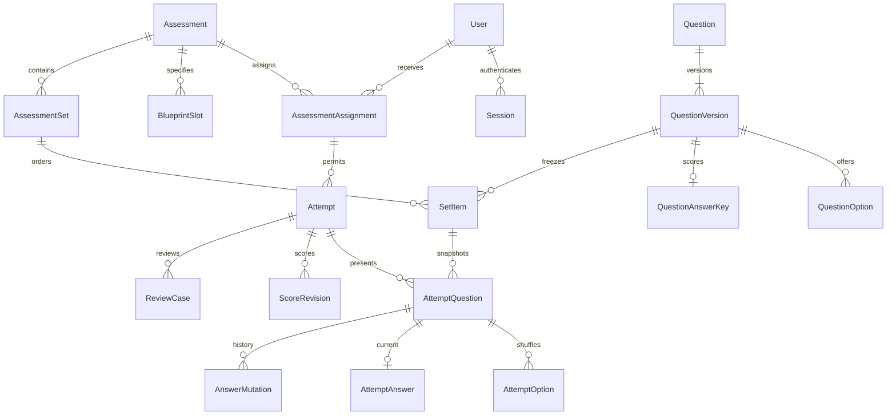

# Database design: one class, one owner

Implemented 13 October 2026 using PostgreSQL and Prisma ORM 7.10.0. The schema is
[`prisma/schema.prisma`](../prisma/schema.prisma); SQL migrations, including the
rules Prisma cannot describe, live in [`prisma/migrations`](../prisma/migrations).

## Scope decisions

- `User` represents an enrolled student or the owner. `isAdmin` defaults to false;
  a partial unique index permits at most one true row. The bootstrap command
  provisions that owner. There are no organisations, cohorts, role/permission
  tables, instructor assignments, or separate enrolment records.
- Student creation/import is enrolment. `disabledAt` revokes access while retaining
  evidence. `AssessmentAssignment` determines which exams each student may take.
- The owner reviews and activates questions. A second instructor is not required.
- Blueprint slots belong directly to an assessment. Reusable blueprint templates
  are deferred. Aggregated incidents use `AttemptEvent` rows rather than a second
  incident table; reviews are linked to the complete attempt timeline.
- The exam safeguards remain: immutable question versions, frozen sets, autosave
  history, retakes, release barriers, score revisions and audit records.

## Relationships



## Storage and optimization decisions

Use native UUID keys and `timestamptz(3)` for instants. All application/seed/test
connection pools explicitly use UTC; only the UI formats Africa/Nairobi time.
Tests compare Prisma-written instants through the PostgreSQL driver because
database session timezone must not shift deadlines. UUID v4 is adequate for one
class; switching IDs, partitioning, replicas and distributed caches is premature.

Graded relationships are normalized. Composite foreign keys prove that an
answer-key option belongs to its version, an attempt uses a set from its assigned
assessment, an attempt question belongs to that set, and selected options were
actually presented for that question. The repeated IDs needed for these composite
keys are constrained, not independent sources of truth. JSONB is limited to rule
snapshots, operational metadata and untrusted late evidence. Recovery-code hashes
are an array of opaque values, not account or grading relationships.

`AttemptAnswer` stores the current selection for cheap resume/scoring reads;
`AnswerMutation` records each accepted change and its idempotency key. One transaction
must write both. No answer row means never answered; a null selection records an
explicit clear. A duplicate mutation is looked up before writing and compared by
payload hash. A uniqueness constraint does not itself return the original receipt.

Draft question edits use an incrementing `recordVersion` for optimistic concurrency;
the immutable question `version` number identifies assessed content. Assessment and
assignment edits use their own recordVersion. An update must compare the expected
value and increment it atomically; a zero-row update means a conflict.

Store score numerators and denominators as integers; compute percentages instead
of persisting a rounded float. `passPercent` is a decimal with two fractional
digits. Compare `rawCorrect * 100` against `availablePoints * passPercent` using
decimal arithmetic; round only for display. Zero available points means ungradable
and requires `passed = null`. Scoring reads the frozen attempt pass threshold.

Indexes follow actual queries:

| Query | Index or key |
| --- | --- |
| Student dashboard | Assignment `(userId, assessmentId)` |
| Resume/retest history | Unique `(assignmentId, attemptNumber)` |
| Prevent simultaneous active attempts | Partial unique assignment key where status is ACTIVE |
| Expiry sweep | Partial `(expiresAt, id)` for ACTIVE attempts |
| Least-used set selection | Attempt `(setId, assessmentId)`; count all attempts including voids |
| Result release barrier | Assignment `(assessmentId, hardCloseAt)` and Attempt `(assessmentId, status)` |
| Answer replay/revision ordering | Unique mutation ID, generation/sequence, and question/revision keys |
| Review timeline | `(attemptId, serverReceivedAt, id)` and mutation acceptance-time index |
| Worker claims/recovery | Partial pending-job and running-lease indexes |
| Authentication/retention | Token hash, user, and expiry indexes |

Unique constraints already provide indexes. Do not add duplicate indexes on their
leftmost prefixes. Keep arbitrary JSONB unindexed until a real query requires it.
Use cursor pagination with `(timestamp, id)` for timelines. Avoid permanently
inserting every heartbeat; update `Attempt.lastSeenAt`. Start with five pooled
connections per process, count web and worker pools together, and measure
`EXPLAIN (ANALYZE, BUFFERS)` on representative data before tuning further. There
is no claim of 300-student load validation at this stage.

## Multiple-select questions

Added 20 October 2026 (`20261020120000_multiple_select`). `QuestionVersion.answerMode` is
`SINGLE` or `MULTIPLE`; `QuestionAnswerKey` has one row per correct option, keyed by
`(questionVersionId, correctOptionId)`. Activation requires exactly one key for `SINGLE`, and
at least one key with three to six options for `MULTIPLE`.

A multiple-select answer is stored as a sorted, distinct `selectedOptionIds` array on
`AttemptAnswer` and `AnswerMutation`, with `selectedOptionId` null; single answers keep using
`selectedOptionId` with an empty array. Arrays cannot carry foreign keys, so a trigger checks
that every selected ID was shown for that attempt question and that the shape matches the
question's mode. Scoring is all-or-nothing: the point is earned only when the selected set
equals the keyed set.

## Database rules versus service rules

The SQL integrity migration enforces the sole admin, one active attempt, positive
counters, schedule bounds, OTP duration/guess bounds, score bounds and composite
membership constraints. Triggers freeze activated question content/options/keys,
published sets/blueprint slots and ordinary published settings. Mutation, score and
audit updates are rejected; retention may explicitly delete eligible history.

Application services still must implement authentication, admin/ownership checks,
MFA enforcement, rate-limit consumption, complete publication validation, set
balance, authorised attempt counts, lifecycle transitions, deadline acceptance,
release and rescore barriers, appeals/retention holds, and meaningful audit reasons.
The schema alone is not an exam engine or an authorization system. `isAdmin` must
never come from a student request or from an email-domain rule. Possessing an
authenticator row does not grant admin access.

Use short transactions. For start, schedule, retest, exclusion and release, lock
Assessment first, then assignments/attempts in ID order. Answer writes lock only
their attempt. After acquiring that row lock, issue a separate
`SELECT clock_timestamp()` and validate the deadline; transaction-start `now()`
can be stale after a lock wait. Check generation/account state under the same lock.
Use the authoritative current answer for delayed/replayed responses. Claim jobs
with `FOR UPDATE SKIP LOCKED`, a lease token and bounded retries. Do not send email
or perform other network calls inside transactions.

`AssessmentAssignment` has no duplicated next-attempt counter or current-attempt
pointer: under its lock, resume its active attempt or allocate max(attemptNumber)+1
within `allowedAttemptCount`. Attempt schedules and rules are preserved snapshots.
To extend an attempt, update its effective hard close and the assignment release
barrier in the same transaction, following assessment-first lock ordering.

## Local setup and migrations

The existing PostgreSQL 17.2 instance was verified on `127.0.0.1:5433`; the server
on 5432 uses different credentials. The dedicated `class_grading` database was
created and all migrations applied by Prisma. Existing unrelated databases
were not migrated. Upgrade the local PostgreSQL patch release before deployment;
17.2 is the installed test environment, not a recommended production patch.

The actual connection URL is in ignored `.env`; `.env.example` contains placeholders.
Prisma CLI reads it through `prisma.config.ts`, and Next.js loads `.env` automatically.
No password belongs in a schema, migration, browser DTO or committed document.

```sh
npm run db:validate
npm run db:generate
npm run db:deploy
npm run db:seed
```

Set your own `ADMIN_EMAIL` and `ADMIN_NAME` before seeding. The seed creates only
the sole owner and an audit entry; it is idempotent and refuses to silently promote
a student or replace a different admin. It does not invent credentials, mark email
verified or bypass MFA setup. Never run seeding during install or build.

For future model changes use `npm run db:migrate -- --name describe_change` against
a development database; Prisma needs permission to create its shadow database.
Use `--create-only` when a migration needs SQL checks, indexes or triggers, review
that SQL, then apply it with Prisma. Production uses `npm run db:deploy` with a
separate migration identity. Do not use `db push` or edit applied migration files.
The running app should use a restricted database login before deployment.

## Verification

`npm run test:db` requires an explicit `TEST_DATABASE_URL` and never defaults to the
application URL. It creates a randomly named schema, applies migrations with
`prisma migrate deploy`, exercises constraints and real concurrent connections,
and drops only that test schema. Test data contains no real students. Use an
isolated test database/user with schema-creation privileges.

The database suite covers single-admin/email rules, answer-key and selection
membership, activation/published-content protection, concurrent attempts, immutable
mutation history, draft edit conflicts, score/schedule/OTP bounds, lock-wait timing
and UTC round trips. Owner bootstrap is checked for idempotence in the test schema.
Since 14 October it also covers write-once release, forward-only scoring revisions,
draft-only assessment inserts, normalized admission numbers and the auth/import
services (browser binding, guess limits, rate counters, pending-MFA sessions, atomic
import). API/browser acceptance tests and load tests remain later milestones.

The `20261014120000_integrity_hardening` migration adds those assessment rules, a
normalized-admission CHECK, StudentImport state checks, lets activated versions bump
`recordVersion`, and sets `fillfactor = 80` on `Attempt` and `AttemptAnswer`. Lock
modes and hot-path rules for the exam engine are in [performance.md](performance.md).

Validation completed 14 October 2026: all 27 database tests passed on PostgreSQL 17.2; lint,
TypeScript and the production build passed; Prisma reports all migrations
applied and no difference between the database and schema. The application
connection was checked against `class_grading` with its session timezone set to
UTC. The production dependency audit reports zero known vulnerabilities; the
existing unpatched lint-only advisory is documented in the security review.

## Research references

- [PostgreSQL constraints](https://www.postgresql.org/docs/17/ddl-constraints.html): use foreign/unique keys for cross-row membership; CHECK cannot validate other rows reliably.
- [Partial indexes](https://www.postgresql.org/docs/17/indexes-partial.html): restrict indexes and uniqueness to the operational subset.
- [Multicolumn indexes](https://www.postgresql.org/docs/17/indexes-multicolumn.html): order B-tree columns around leading query predicates.
- [Explicit locking](https://www.postgresql.org/docs/17/explicit-locking.html): row locks serialize competing updates; use consistent lock order.
- [Prisma 7 transactions](https://www.prisma.io/docs/orm/v7/prisma-client/queries/transactions): keep transactions short and retry recognized conflicts within bounds.
- [Prisma 7 generator](https://www.prisma.io/docs/orm/v7/prisma-schema/overview/generators) and [configuration](https://www.prisma.io/docs/orm/v7/reference/prisma-config-reference): generated TypeScript client, driver adapter and separate CLI connection config.
- [Connection pools](https://www.prisma.io/docs/orm/v7/prisma-client/setup-and-configuration/databases-connections/connection-pool): the PostgreSQL driver owns pool limits in Prisma 7.
